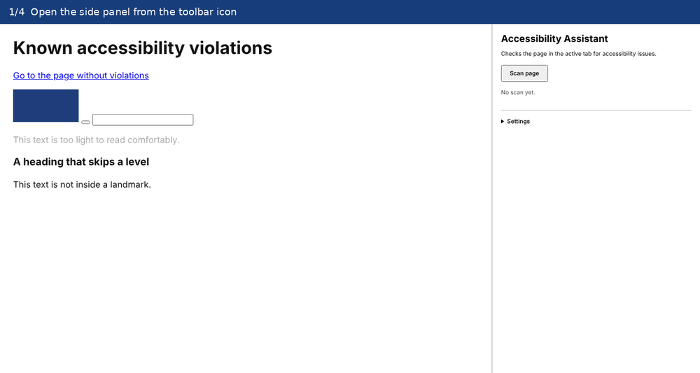

# Accessibility Assistant

[](https://github.com/oksana-kyrylchuk/a11y-assistant/actions/workflows/ci.yml)

A browser extension for Chrome and Opera (Manifest V3, React, TypeScript). A side panel scans the open page with [axe-core](https://github.com/dequelabs/axe-core), lists the issues by severity, shows each failing element on the page, and can ask Google Gemini why an issue matters and how to fix it.



## What it does

- **Scan.** Runs axe-core in the active tab and groups the violations into critical, serious, moderate and minor.
- **Show.** Selecting an element scrolls the page to it and draws an outline around it, including elements inside open shadow roots.
- **Keep results honest.** Results belong to one page: they are cleared after a reload, a link or a switch to another tab (a jump to an anchor keeps them).
- **Explain (optional).** Sends one issue and the element's HTML to the Gemini API and shows a short explanation and a corrected snippet. Works with your own API key; everything else works without one.

## How it works

| Part | Responsibility |
|---|---|
| `src/background/service-worker.ts` | Opens the side panel on the toolbar click and makes the request to Gemini |
| `src/sidepanel/` | The React side panel: scan, results, selection, explanations, settings |
| `src/lib/scan.ts`, `highlight.ts` | Inject axe-core and the outline into the page with `chrome.scripting` |
| `src/lib/results.ts`, `explanation.ts` | Pure functions that turn axe results and model answers into what the panel shows |
| `src/lib/gemini.ts` | The only module that knows the LLM provider: prompt, request, error messages |

A few decisions worth knowing:

- **`activeTab` instead of host permissions.** The extension can only read a page after you click its icon on that tab. The panel opens from `chrome.action.onClicked` rather than `openPanelOnActionClick`, because the declarative behaviour opens the panel without granting `activeTab`.
- **The API key stays out of the page.** The key lives in `chrome.storage.local`, which is limited to trusted contexts, so scripts injected into pages cannot read it. Only the service worker attaches it to requests.
- **The model's answer is shown as text.** Paragraphs and code blocks are split out and rendered as plain text; nothing from the model is inserted as HTML. The page's HTML in the prompt is marked as data, not instructions.
- **Time limit.** Gemini requests time out after 25 seconds, under the 30 seconds after which Chrome stops an extension service worker that waits for a response. The default model is a Flash-Lite model, which answers in about a second.

## Permissions

| Permission | Why |
|---|---|
| `activeTab` | Read the tab you clicked the icon on, and only that tab |
| `scripting` | Inject axe-core and the outline into that tab |
| `sidePanel` | Show the panel |
| `storage` | Keep the Gemini API key and model on this device |
| `https://generativelanguage.googleapis.com/*` | Call the Gemini API for **Explain** |

## Privacy

Scanning and highlighting happen in your browser; nothing leaves it. **Explain** sends the rule, axe's summary and the HTML of that one element to Google. On the free tier of the Gemini API, Google may use this content to improve its products. The extension has no server and collects nothing.

## Run locally

Requires Node 22.

```sh
npm install
npm run build
```

Then load the `dist` folder as an unpacked extension:

- Chrome: `chrome://extensions` → enable **Developer mode** → **Load unpacked**
- Opera: `opera://extensions` → enable **Developer mode** → **Load unpacked**

Click the extension icon in the toolbar to open the side panel. To try it on a page with known issues, run `npm run test-page` and open http://localhost:5180/violations.html.

For **Explain**, create an API key in [Google AI Studio](https://aistudio.google.com/), open **Settings** at the bottom of the panel and paste it there. The model can be changed in the same place.

`npm run dev` rebuilds `dist` on every change; reload the extension on the extensions page to pick it up.

## Tests

```sh
npm test            # unit tests (Vitest)
npm run test:e2e    # builds the extension and runs the Playwright tests
```

- **Unit tests** cover parsing axe results and model answers, the request to Gemini and every error message.
- **End-to-end tests** load the built extension into Chromium and click its toolbar icon through the `Extensions.triggerAction` DevTools command. That click is what grants `activeTab`, so the tests take the same path as a user. They check the scan result against the expected list in [`test-pages/README.md`](test-pages/README.md), the outline, clearing results, **Explain** with mocked Gemini responses, and that pages cannot read the API key.
- **The panel's own accessibility** is tested too: axe finds no violations in the light and dark themes, scanning and selecting work with the keyboard and keep focus, and the panel fits a 320 px width.

Install the browser once with `npx playwright install chromium`. CI runs lint, type checks, unit and end-to-end tests on every push to `main`.

## Limitations

- Only the top document is scanned; elements inside iframes are not.
- Results are not kept per tab: after returning to a tab, scan again.
- The outline stays on the page if the panel is closed; it goes away with the next scan or a reload.
- Not published in the Chrome Web Store or Opera add-ons.
